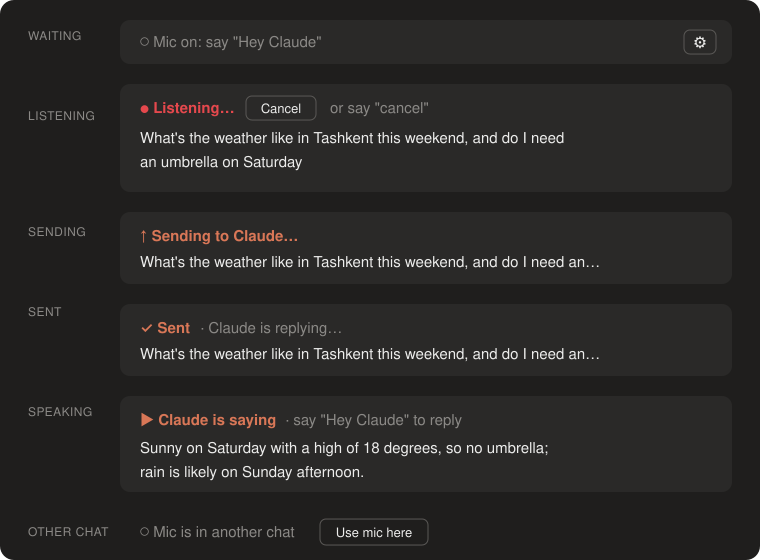
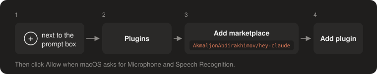

# hey-claude

Talk to Claude hands-free in the Claude desktop app on macOS and Windows. Say **"Hey Claude"**,
ask your question, and Claude answers. A short spoken summary of the answer is read
aloud and shown above the prompt box.

It runs inside Claude only: the plugin starts a small listener when a Claude Code
session starts and stops it when the session ends. Speech recognition runs on your
computer (Apple's on macOS, Windows' own on Windows): your voice never leaves it.



## Install



In the Claude desktop app: click **+** next to the prompt box, then **Plugins**,
**Add marketplace**, type `AkmaljonAbdirakhimov/hey-claude`, then **Add plugin**.

Or, in a Claude Code terminal session:

```
/plugin install hey-claude --marketplace AkmaljonAbdirakhimov/hey-claude
```

Answer `y` to add the marketplace, then pick a scope (user scope puts it in every chat).

On macOS, the first time it runs, macOS asks for **Microphone** and **Speech Recognition**
access. Click **Allow** for both. Nothing needs to be built or configured.

## Use

- Say **"Hey Claude"** (or just **"Claude"** at the start of a sentence), then your request.
  You can pause while you think; 4 seconds of quiet sends it.
- The bar above the prompt box shows what is happening: `○ Mic on`, `● Listening…`
  with your words, `↑ Sending…`, `✓ Sent`, then `▶ Claude is saying` with the summary.
  The **⚙️** at its right end picks the voice.
- Changed your mind? Press **Cancel** in the bar, or end with **"cancel"** or
  **"never mind"**, and nothing is sent.
- Say **"Hey Claude, stop"**, or type a prompt, to stop the speech.
- Don't want it listening for a while? Click **⚙️**, then **Turn off**. The mic closes in
  every chat, summaries are no longer read aloud, and the bar shows `○ Mic off` with a
  **Turn on** button.
- With several chats open, one has the mic: the last chat you typed in. Other chats
  show **Use mic here** to take it.

## Requirements and limits

- macOS 13 or later (Apple Silicon or Intel), or Windows 10 or 11.
- The Claude desktop app, or Claude Code in a terminal, recent enough for plugin
  hooks modules (tested with Claude Code 2.1.326).
- English only by default. Apple's on-device recognizer must support the language;
  Uzbek, for one, is not supported.
- The wake phrase works best said on its own, at the start of what you say. "Hey Claude"
  in the middle of a sentence is ignored on purpose.
- The summary is spoken in the voice you pick (below); one that is not installed
  falls back to the system's default voice.
- Summaries are written by Claude Haiku, which uses your Claude plan. Each one gives the
  result first, then the detail that matters, then what happens next: a question Claude
  asked you is read word for word. One-line answers are read as they are.

## Choose the voice

Click **⚙️** at the right end of the bar. A list of the English voices on your computer
opens; pick one and it says hello in that voice. The choice is saved for every chat.
Press **Done** or Esc to close the list.

The default is your system's own voice, from the plugin's **Voice** setting (`/config` in a
terminal session). A voice picked in the bar wins over that setting.

Premium and Enhanced voices sound much better than the built-in ones and are listed
first. Download them in System Settings > Accessibility > Spoken Content > System Voice >
**Manage Voices**, then open the list again.

## Windows

Windows support is new and has not been tested on a Windows PC yet. Reports are welcome.

- It uses Windows' built-in offline speech recognizer and voices, through Windows
  PowerShell. Nothing to install or build.
- Microphone: Settings > Privacy & security > Microphone > turn on **Let desktop apps
  access your microphone**.
- Speech: an English (United States) speech pack must be installed: Settings > Time &
  language > Speech, or Language > English (United States) > Options > Speech.
- Recognition is less accurate than on macOS. Speak clearly, and say "Hey Claude"
  as its own short phrase.
- Voices are the Windows desktop voices, such as Microsoft David, Zira and Mark. The
  newer Natural voices of Narrator are not available to apps.
- The listener is `listener/windows.ps1`. Its settings are parameters: `-Locale`,
  `-Silence`, `-FirstWord` and `-MinConfidence` (how sure it must be of the wake phrase).

## Advanced settings (macOS)

Edit `listener/main.swift`, then run `./build.sh`:

- Language: the listener takes `--locale ru-RU` (default `en-US`).
- Timing: `--silence 4` seconds of quiet send the request; `--first-word 8` seconds to
  start talking after "Hey Claude".
- Wake phrase: a greeting (`--greetings`) followed by a name (`--names`), or a name alone
  at the start (`--bare-names`). The defaults include common mishearings.

## Troubleshooting

- Nothing happens: check System Settings > Privacy & Security > Microphone and Speech
  Recognition, and allow `hey-claude` (or Claude).
- `listener.log` in the plugin folder traces what the recognizer heard in the chat that
  has the mic. It starts empty each time that chat takes the mic and never leaves your
  computer. Delete the `--log` argument in `hooks/register.tsx` to turn it off.

## Build (macOS)

```bash
./build.sh
```

Compiles `listener/main.swift` into a universal `bin/hey-claude` (Apple Silicon and Intel)
and runs its self-test. Needs the Xcode command line tools.
